# Командний проєкт: дорожня карта

Цей файл — дві речі одночасно:

1. **Інструкція** — що робить команда, у якому порядку, як усе запускати і що саме треба написати в кожній з шести задач.
2. **Таблиця команди** — у самому кінці файлу. Кожен у своїй гілці дописує туди **один рядок**. Текст вище таблиці не змінюємо: якщо його правитимуть кілька людей, кожен PR конфліктуватиме.

> Таблиця має лишатися **останньою** в цьому файлі. Новий рядок — завжди в самий кінець.

**Зміст**

1. [Що ми будуємо і навіщо](#1-що-ми-будуємо-і-навіщо)
2. [Карта модулів: хто від кого залежить](#2-карта-модулів-хто-від-кого-залежить)
3. [Як запускати і як читати результат](#3-як-запускати-і-як-читати-результат)
4. [Дорожня карта: чотири етапи](#4-дорожня-карта-чотири-етапи)
5. [Шість задач — детально](#5-шість-задач--детально)
6. [Коли щось пішло не так](#6-коли-щось-пішло-не-так)
7. [Перевір себе](#7-перевір-себе)
8. [Команда](#8-команда)

---

## 1. Що ми будуємо і навіщо

**Задача кафе.** Наприкінці місяця каса вивантажує текстовий файл `kasa_2024_07.txt`: один рядок — один чек. Власниця хоче звіт: скільки чеків, виторг, середній чек, найкращий день, розподіл за днями і прийомами їжі. Касирові потрібен перелік зіпсованих рядків, щоб їх виправити.

У уроках 13–15 кожен з вас **сам** зібрав такий звіт. Тепер те саме робить **команда з шести людей**, і головне питання вже не «як написати функцію», а:

- як шістьом людям працювати в одному репозиторії й не затирати файли одне одного;
- як почати свою частину, **не чекаючи** інших;
- як зробити, щоб після злиття всіх частин програма запрацювала одразу, без «а в мене працювало».

Відповідь — **Git + GitHub** (гілки, Pull Request-и, рев'ю) і **контракти з тестами** (кожна функція обіцяє, що прийме і що поверне, а тести це перевіряють).

### Як дані проходять через програму

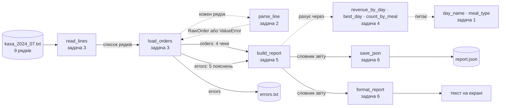

Усі ці функції з'єднує `main.py` (його дає викладач). Подивись його — це 20 рядків, і з них видно весь проєкт: прочитати → розібрати → порахувати → зберегти → надрукувати.

### Що лежить у файлі каси

Ці дев'ять рядків — тестовий приклад для всієї команди. Чотири правильні, п'ять зіпсованих, і кожен зіпсований зіпсований **по-своєму**:

| Рядок файлу | Номер | Результат | Чому |
|---|---|---|---|
| `2024-07-19 18:30;540.00;50;2` | рядок 1 | ✅ чек | пт, вечеря |
| `2024-07-19 12:10;320.00;30;1` | рядок 2 | ✅ чек | пт, обід — **раніше** за рядок 1! |
| `2024-07-19 19:05;540,00;40;3` | рядок 3 | ❌ | кома замість крапки: `float("540,00")` не вміє |
| `2024-07-20 20:15;980.00;120;4` | рядок 4 | ✅ чек | сб, вечеря |
| `2024-07-20 13:40;760.00` | рядок 5 | ❌ | лише 2 поля замість 4 |
| `2024-02-30 19:00;450.00;0;5` | рядок 6 | ❌ | 30 лютого не існує |
| `2024-07-21 18:00;-120.00;0;2` | рядок 7 | ❌ | сума чека від'ємна |
| `2024-07-21 14:20;610.00;60;0` | рядок 8 | ❌ | 0 гостей |
| `2024-07-21 21:30;1200.00;150;6` | рядок 9 | ✅ чек | нд, вечеря |

Звідси й очікуваний результат з `README.md`: 4 чеки, 5 пропущених рядків, виторг 540 + 320 + 980 + 1200 = 3040 грн, середній чек 760 грн, найкращий день — неділя.

---

## 2. Карта модулів: хто від кого залежить

Стрілка означає «імпортує». Сірі файли дає викладач — їх **не змінюємо**.

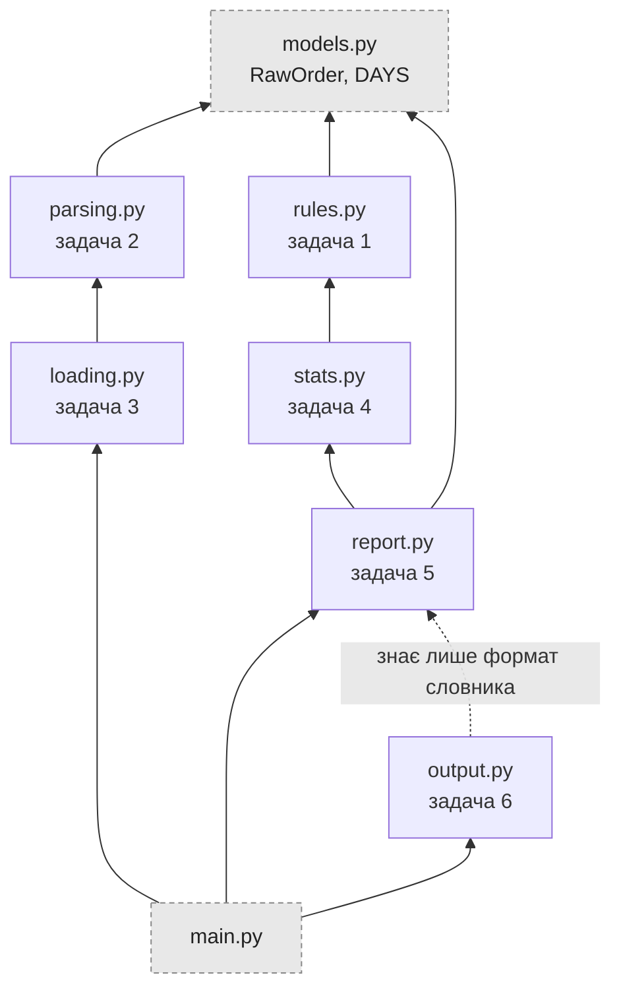

Зверни увагу: задача 5 імпортує задачу 4, а та — задачу 1. Здається, що задачу 5 можна почати лише тоді, коли готові 4 і 1. **Ні.** Ось чому.

### Контракт і заглушки: чому всі працюють паралельно

**Контракт** — це докстрінг функції: що вона приймає, що повертає, що робить з поганими даними. Наприклад:

```python
def best_day(revenue):
    """День з найбільшим виторгом; для порожнього словника — None."""
```

Автор задачі 5 не знає, **як** автор задачі 4 напише `best_day`. Йому досить знати, **що** вона поверне. А тести задачі 5 на час перевірки підставляють замість справжньої `best_day` маленьку **заглушку** (fake), яка повертає саме те, що обіцяє контракт:

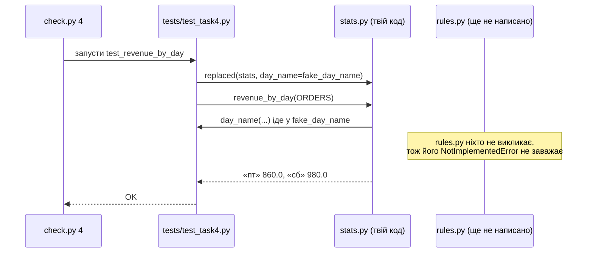

Як це влаштовано — у `tests/helpers.py`, функція `replaced`. Відкрий `tests/test_task4.py` і знайди там `fake_day_name`: вона знає лише два дні, але цього досить, щоб перевірити твій підрахунок.

**Наслідок:** задачі можна робити й перевіряти в будь-якому порядку. А от **чи пасують частини одна до одної**, покаже лише інтеграційний тест `python check.py all` — коли в `main` злито всі шість PR.

### Задачі одним поглядом

| № | Файл і функції | Складність | Від кого залежить | Пригадай уроки |
|---|---|---|---|---|
| **1** | `rules.py`: `meal_type`, `day_name` | ★☆☆ | ні від кого | 4, 5, 13 |
| **2** | `parsing.py`: `parse_line` | ★★☆ | `models.py` | 5, 13, 14 |
| **3** | `loading.py`: `read_lines`, `load_orders` | ★★☆ | задача 2 (заглушка в тестах) | 6, 14, 15 |
| **4** | `stats.py`: `revenue_by_day`, `best_day`, `count_by_meal` | ★★☆ | задача 1 (заглушка в тестах) | 6, 8 |
| **5** | `report.py`: `build_report` | ★★★ | задача 4 (заглушка в тестах) | 6, 13, 15 |
| **6** | `output.py`: `save_json`, `format_report` | ★★☆ | лише формат словника задачі 5 | 6, 8, 15 |

**Якщо вас менше, ніж шість**, хтось бере дві задачі, але кожна все одно у **своїй** гілці й своєму PR. Зручні пари: 1 + 4 (правила і підрахунки за ними), 2 + 3 (розбір рядка і розбір файлу), 5 + 6 (звіт і його вивід).

---

## 3. Як запускати і як читати результат

### Де і чим запускати

Усі команди виконуються **в терміналі, з кореня проєкту** — з теки, де лежать `check.py` і `main.py`. Інакше Python не знайде `models.py` і `tests/`.

```bash
cd cafe-kasa-team-1      # або lesson_16_git_github_system/team_project у репозиторії курсу
python --version         # потрібен Python 3.10+
ls                       # мають бути check.py, main.py, models.py, tests/ …
```

| Де працюєш | Як відкрити термінал | Команда Python |
|---|---|---|
| Windows | PyCharm → **Terminal** (`Alt+F12`), або Git Bash | `python` |
| macOS / Linux | будь-який термінал | `python3` (якщо `python` не знайдено) |
| Ноутбук уроку 16 / Colab | клітинка `%%bash`, першим рядком `cd team-demo` | `python3` |

**PyCharm без термінала.** Правий клік на `check.py` → **Run**. Щоб передати номер задачі: **Run → Edit Configurations… → Parameters**: `3` (або `all`). Working directory має бути коренем проєкту — PyCharm ставить його сам, якщо `check.py` лежить у корені.

### Що коли запускати

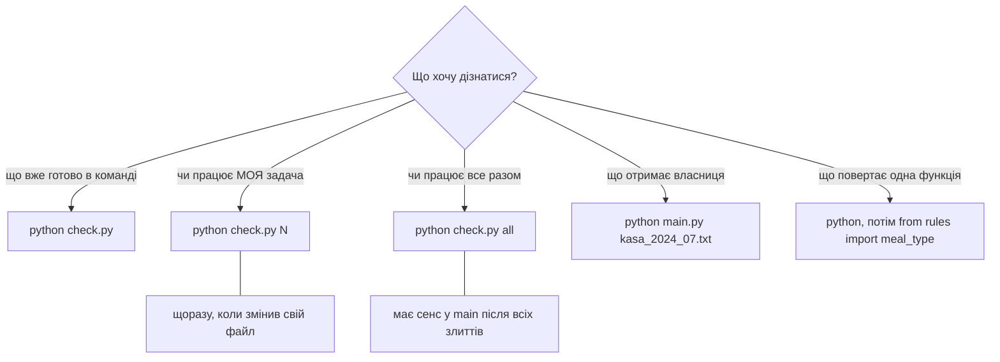

### `python check.py` — таблиця команди

Нічого не пояснює, лише показує стан. На старті:

```text
⏳ 1. rules.py — день тижня і прийом їжі: 0/2
⏳ 2. parsing.py — розбір рядка каси: 0/3
⏳ 3. loading.py — читання файлу і всіх рядків: 0/3
⏳ 4. stats.py — підрахунки за днями і прийомами їжі: 0/3
⏳ 5. report.py — словник звіту: 0/2
⏳ 6. output.py — JSON і текст звіту: 0/3
```

Коли злито задачі 1 і 4, а в задачі 1 ще й баг на межі:

```text
❌ 1. rules.py — день тижня і прийом їжі: 1/2
⏳ 2. parsing.py — розбір рядка каси: 0/3
⏳ 3. loading.py — читання файлу і всіх рядків: 0/3
✅ 4. stats.py — підрахунки за днями і прийомами їжі: 3/3
…
```

| Значок | Що означає |
|---|---|
| ✅ | усі тести задачі пройшли |
| ⏳ | задача ще не написана: у файлі лишився `raise NotImplementedError` |
| ❌ | код написаний, але хоча б один тест каже «не так» |

`1/2` — пройдено 1 тест з 2.

### `python check.py N` — тести твоєї задачі

Головна команда, поки працюєш. Показує **кожен тест окремо**:

```text
Задача 1: rules.py — день тижня і прийом їжі
  test_meal_type_borders: НЕ ПРОЙДЕНО обід починається об 11
  test_day_name: OK
```

Можливі статуси:

| Статус | Що сталося | Що робити |
|---|---|---|
| `OK` | тест пройшов | нічого |
| `ще не зроблено — задача 3: напиши read_lines()` | функцію не написано, лишився `NotImplementedError` | написати її |
| `НЕ ПРОЙДЕНО обід починається об 11` | функція повернула не те; текст після — підказка з тесту | відкрити `tests/test_taskN.py`, знайти цю підказку і подивитися, що саме очікували |
| `НЕ ПРОЙДЕНО` без підказки | теж неправильний результат, але тест без пояснення | так само — читати рядок `assert` у тесті |
| `ПОМИЛКА TypeError: … (stats.py, рядок 9)` | твій код **упав** з винятком | відкрити вказаний файл і рядок |

> Тести — це теж документація. Якщо контракт у докстрінгу незрозумілий, відкрий `tests/test_taskN.py`: там конкретні входи й очікувані виходи.

### `python check.py all` — увесь проєкт

Запускає тести всіх шести задач і **інтеграційний тест**: справжній `main.py` на справжньому `kasa_2024_07.txt`. Поки хоч одна задача не злита в `main`, кінець буде таким:

```text
Інтеграційний тест: увесь проєкт разом
  test_full_report: ще не зроблено — задача 3: напиши read_lines()
  test_missing_file: ще не зроблено — задача 3: напиши read_lines()
❌ Проєкт ще не працює — дивись рядки вище
```

Ціль усієї команди — щоб у `main` останній рядок був:

```text
✅ Проєкт працює!
```

### `python main.py kasa_2024_07.txt` — сама програма

Це те, що запускатиме адміністратор кафе. Коли всі задачі злито:

```text
Чеків: 4, пропущено рядків: 5
Виторг: 3040.00 грн, середній чек: 760.00 грн
Найкращий день: нд
За днями: пт 860.00, сб 980.00, нд 1200.00
За прийомом їжі: вечеря 3, обід 1
```

Поруч з'являться два файли (Git їх ігнорує — див. `.gitignore`):

- `report.json` — той самий звіт для сайту чи бухгалтера;
- `errors.txt` — для касира:

  ```text
  рядок 3: could not convert string to float: '540,00'
  рядок 5: очікували 4 поля, а маємо 2
  рядок 6: day is out of range for month
  рядок 7: сума чека має бути більшою за 0, а маємо -120.0
  рядок 8: гостей має бути хоча б один, а маємо 0
  ```

  Рядки 3 і 6 — англійською: це повідомлення самого Python. Як зробити їх зрозумілими касирові — у «Поглибленні» задачі 2.

Інші запуски:

```bash
python main.py                     # Використання: python main.py ФАЙЛ_КАСИ, наприклад: …
python main.py kasa_2024_08.txt    # Немає файлу каси: kasa_2024_08.txt
```

Поки не всі задачі злиті, `main.py` падає з `NotImplementedError` і трасуванням — це нормально, а не баг.

### Перевірити одну функцію руками

Коли тест незрозумілий, виклич функцію сам — в інтерактивному Python з кореня проєкту:

```text
$ python
>>> from rules import meal_type
>>> meal_type(11), meal_type(16)
('обід', 'інше')
>>> from parsing import parse_line
>>> parse_line("2024-07-19 18:30;540.00;50;2")
RawOrder(total_bill=540.0, tip=50.0, size=2, timestamp=datetime.datetime(2024, 7, 19, 18, 30))
>>> exit()
```

Після зміни файлу треба вийти (`exit()`) і зайти знову: `import` не перечитує вже завантажений модуль.

> Пригадай: [урок 13, розділи 5–6 — `if __name__ == "__main__"` і `sys.argv`](https://github.com/NikoriakViktot/PY-Course-Victor-Nikoriak-22-09-2026/blob/main/module_1/lessons/lesson_13_modules_stdlib/note_lesson_13_modules_stdlib_student.ipynb): саме так `main.py` і `check.py` отримують аргументи з командного рядка.

---

## 4. Дорожня карта: чотири етапи

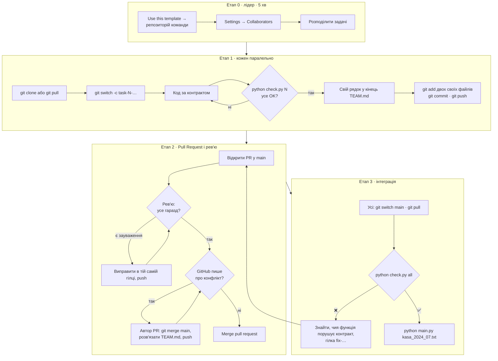

### Етап 0 — лідер готує репозиторій

**Навіщо:** у всіх має бути **один** спільний репозиторій з однаковим стартом: шаблоном, тестами й заглушками. Від цього коміту кожен відгалузиться.

Нічого копіювати не треба: проєкт уже лежить у шаблоні **[NikoriakViktot/cafe-kasa-template](https://github.com/NikoriakViktot/cafe-kasa-template)**.

1. Відкрити шаблон → зелена кнопка **Use this template** → **Create a new repository**.
2. Owner — свій акаунт, назва — наприклад `cafe-kasa-team-1`, **Public** → **Create repository**. Репозиторій команди з'явиться з одним комітом: шаблон, тести, заглушки.
3. **Settings → Collaborators → Add people** — додати всіх. Кожен має **прийняти запрошення** (лист на пошту або сповіщення на GitHub), інакше `git push` поверне `Permission denied`.
4. *(Необов'язково, але корисно)* **Settings → Branches → Add rule** для `main`: «Require a pull request before merging». Тоді випадковий `git push` у `main` просто не пройде.
5. Розподілити задачі й рецензентів. Простий спосіб — по колу: автор задачі N переглядає PR задачі N+1, автор задачі 6 — задачі 1.

> Пригадай: [урок 16, розділ 1 «Ірина створює репозиторій» і розділ 9 «Тепер — командою на GitHub»](https://github.com/NikoriakViktot/PY-Course-Victor-Nikoriak-22-09-2026/blob/main/module_1/lessons/lesson_16_git_github_system/note_lesson_16_git_github_system_student.ipynb).

### Етап 1 — кожен робить свою задачу у своїй гілці

**Навіщо гілка:** `main` — це версія, яка завжди має бути робочою. Поки ти пишеш і помиляєшся, ти робиш це у своїй гілці: інші цього не бачать і не страждають. Гілка — лише вказівник на коміт, файли не копіюються.

```bash
git clone https://github.com/ЛІДЕР/cafe-kasa-team-1.git      # один раз
cd cafe-kasa-team-1
python check.py                  # таблиця: усе ⏳ — це нормально, ще ніхто нічого не зробив
git switch -c task-3-loading     # своя гілка: task-НОМЕР-файл
```

Назви гілок: `task-1-rules`, `task-2-parsing`, `task-3-loading`, `task-4-stats`, `task-5-report`, `task-6-output`.

Далі — цикл, доки тести не стануть зеленими:

```bash
# пишеш код у своєму файлі
python check.py 3                # лише тести твоєї задачі
```

Коли всі тести `OK`:

```bash
# допиши свій рядок у САМИЙ КІНЕЦЬ TEAM.md, наприклад:  | 3 | loading.py | Твоє ім'я |
git status --short               # мають бути змінені рівно 2 файли: твій .py і TEAM.md
git add loading.py TEAM.md       # не "git add ." — так легко захопити зайве
git commit -m "Задача 3: read_lines і load_orders"
git push -u origin task-3-loading
```

### Етап 2 — Pull Request і рев'ю

**Навіщо PR:** це запит «візьміть мої зміни в `main`», і поки його не прийняли, ще одна людина може подивитися код. Рев'ю ловить те, чого тести не бачать: незрозумілі імена, зайві `print`, змінені чужі файли.

1. Після `git push` GitHub покаже кнопку **Compare & pull request**. Base — `main`, compare — твоя гілка. У назві — номер задачі, в описі — що зроблено і що `python check.py N` проходить. Покроково — [у книзі: Pull Request](https://nikoriakviktot.github.io/PY-Course-Victor-Nikoriak-22-09-2026/00_getting_started/github/pull_request/).
2. Рецензент перевіряє за чеклистом:
   - [ ] у вкладці **Files changed** рівно два файли: свій `.py` і `TEAM.md`;
   - [ ] у `TEAM.md` додано один рядок у кінець, решта не змінена;
   - [ ] тести проходять у нього локально:
     ```bash
     git fetch
     git switch task-3-loading
     python check.py 3
     ```
   - [ ] функції **повертають** результат (`return`), а не друкують його;
   - [ ] код читається: зрозумілі імена змінних, немає закоментованого сміття.
3. Зауваження — коментарем у PR. Автор виправляє **в тій самій гілці** і робить `git push`: PR оновиться сам, новий створювати не треба.
4. Усе гаразд → **Approve** → **Merge pull request** → **Delete branch**.
5. Після кожного злиття **всі**:

   ```bash
   git switch main
   git pull
   ```

   Якщо твій PR ще відкритий, підтягни свіжий `main` у свою гілку — див. [розділ 6](#6-коли-щось-пішло-не-так).

Ось як виглядає життя однієї задачі від початку до злиття:

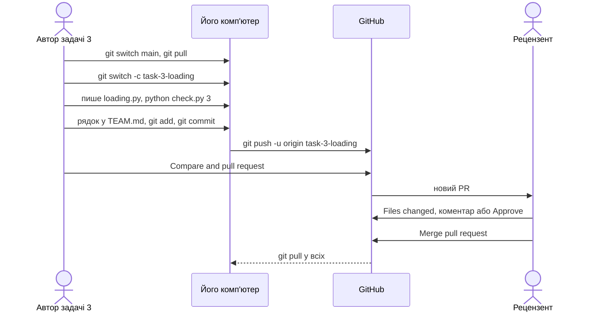

А так — історія репозиторію, коли кілька людей працюють паралельно (задачі 5 і 6 виглядають так само):

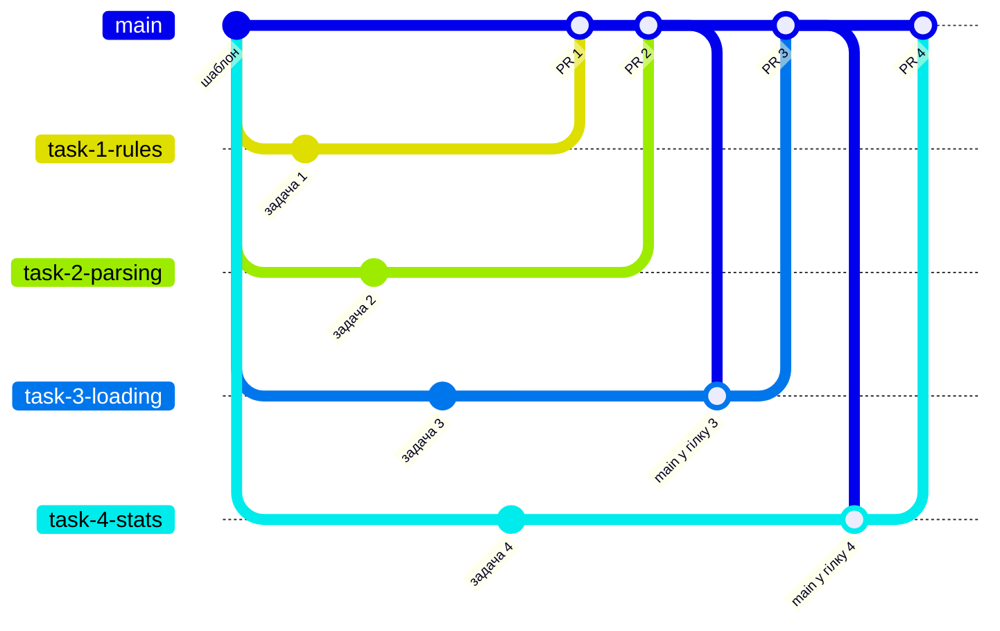

Чому гілки 3 і 4 підтягують `main` перед злиттям? Бо всі дописали рядок у кінець `TEAM.md` — **в одне й те саме місце**. Python-файли зливаються самі (кожен змінювала одна людина), а `TEAM.md` конфліктує. Це нормально і розв'язується за хвилину.

### Етап 3 — інтеграція: чи працює проєкт

**Навіщо:** Git порівнює **текст**, а не сенс. Шість PR можуть злитися без жодного конфлікту, а програма все одно впаде — наприклад, якщо `build_report` повертає ключ `"count"`, а `format_report` читає `"orders"`. Це ловить лише інтеграційний тест.

```bash
git switch main
git pull
python check.py all                  # усі задачі + tests/test_integration.py
python main.py kasa_2024_07.txt      # має надрукувати рівно те, що в README.md
git status --short                   # порожньо: report.json і errors.txt ігнорує .gitignore
```

Готово, коли `check.py all` друкує `✅ Проєкт працює!`.

Якщо всі задачі окремо `OK`, а інтеграція — ні, значить хтось пройшов **свої тести**, але не виконав **контракт**. Прочитай повідомлення: `check.py` показує файл і рядок, де впало. Виправлення — як звичайна задача: гілка `fix-…`, коміт, PR, рев'ю.

---

## 5. Шість задач — детально

Для кожної задачі: роль у проєкті → контракт → схема → план → що перевіряють тести → типові помилки → що пригадати → коли готово.

Розв'язку в репозиторії команди немає — він у викладача. Спирайся на контракт і тести.

### Задача 1 — `rules.py` — день тижня і прийом їжі

**Роль у проєкті.** Це «правила кафе»: о котрій годині обід, а о котрій вечеря, і як назвати день тижня. Ці правила потрібні в кількох місцях (зараз — у задачі 4), тому вони живуть **в одному файлі**. Зміниться розклад обідів — правимо один рядок тут, а не шукаємо по всьому проєкту.

**Чому важливо.** Найпростіша задача, але на ній тримається задача 4. Помилка на межі (16:00 — це що?) тихо зіпсує весь розподіл за прийомами їжі.

**Контракт.**

| Виклик | Результат |
|---|---|
| `meal_type(10)` | `"інше"` — ще не обід |
| `meal_type(11)` … `meal_type(15)` | `"обід"` — обидві межі **включно** |
| `meal_type(16)` | `"інше"` — перерва між обідом і вечерею |
| `meal_type(17)` … `meal_type(23)` | `"вечеря"` |
| `day_name(datetime(2024, 7, 19, 18, 30))` | `"пт"` |
| `day_name(datetime(2024, 7, 15, 9, 0))` | `"пн"` |

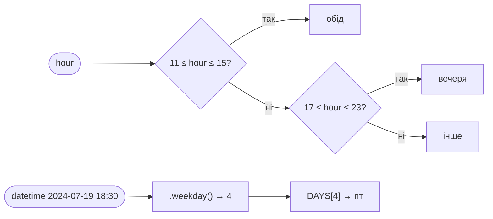

**План.**

1. `meal_type`: дві умови і значення за замовчуванням. Python уміє ланцюжок порівнянь: `11 <= hour <= 15`.
2. `day_name`: у `datetime` є метод `.weekday()` — понеділок `0`, неділя `6`. А в `models.py` уже є кортеж `DAYS = ("пн", "вт", …, "нд")` у тому самому порядку. Залишилося поєднати їх індексом.
3. `python check.py 1`.

**Що перевіряють тести** (`tests/test_task1.py`): усі межі — 10, 11, 15, 16, 17, 23; три конкретні дати; і що для кожного дня липня результат лежить у `DAYS`.

**Типові помилки.**

- `11 < hour <= 15` замість `11 <= hour` — тоді 11:00 стане «інше». `check.py 1` скаже: `НЕ ПРОЙДЕНО обід починається об 11`.
- `.isoweekday()` замість `.weekday()` — він рахує з 1, усі дні зсунуться на один, а неділя впаде з `IndexError`.
- `timestamp.strftime("%a")` — поверне `"Fri"` англійською, а не `"пт"`.
- Свій список днів у `rules.py` замість `DAYS` з `models.py` — дві копії однієї правди рано чи пізно розійдуться.

**Пригадай.**

- [Урок 4 — `if` / `elif` / `else`, порядок умов](https://github.com/NikoriakViktot/PY-Course-Victor-Nikoriak-22-09-2026/blob/main/module_1/lessons/lesson_04_conditions_and_control/note_lesson_04_conditions_student.ipynb) · [книга](https://nikoriakviktot.github.io/PY-Course-Victor-Nikoriak-22-09-2026/modules/m1/lesson_04/)
- [Урок 5 — кортеж, індекси](https://github.com/NikoriakViktot/PY-Course-Victor-Nikoriak-22-09-2026/blob/main/module_1/lessons/lesson_05_lists_tuples_sets/note_lesson_05_lists_tuples_sets_student.ipynb) · [книга](https://nikoriakviktot.github.io/PY-Course-Victor-Nikoriak-22-09-2026/modules/m1/lesson_05/)
- [Урок 13, розділ 8 — `datetime` і `.weekday()`](https://github.com/NikoriakViktot/PY-Course-Victor-Nikoriak-22-09-2026/blob/main/module_1/lessons/lesson_13_modules_stdlib/note_lesson_13_modules_stdlib_student.ipynb) · [книга](https://nikoriakviktot.github.io/PY-Course-Victor-Nikoriak-22-09-2026/modules/m1/lesson_13/)
- [Урок 16, вправа 1](https://github.com/NikoriakViktot/PY-Course-Victor-Nikoriak-22-09-2026/blob/main/module_1/lessons/lesson_16_git_github_system/note_lesson_16_git_github_system_student.ipynb) — ти вже писав саме цю задачу в навчальному репозиторії.

**Готово, коли:** `python check.py 1` → 2/2 `OK`; змінено лише `rules.py` і рядок у `TEAM.md`.

---

### Задача 2 — `parsing.py` — розбір одного рядка каси

**Роль у проєкті.** Це «вхідні двері» для даних: рядок тексту з каси перетворюється на `RawOrder` — кортеж з полями, з яким уже можна рахувати. Усе, що далі, вірить, що `RawOrder` правильний. Тому саме тут відсіюємо сміття.

**Чому важливо.** Якщо `parse_line` пропустить чек із сумою `-120`, виторг місяця буде неправильний, і ніхто не дізнається чому. Якщо ж вона впаде на зіпсованому рядку не тим винятком, `load_orders` його не зловить, і звіту не отримає ніхто.

**Контракт.**

```python
parse_line("2024-07-19 18:30;540.00;50;2")
# → RawOrder(total_bill=540.0, tip=50.0, size=2, timestamp=datetime(2024, 7, 19, 18, 30))
```

Зіпсований рядок → **`ValueError`** з поясненням. Будь-який інший виняток (`IndexError`, `TypeError`) — порушення контракту: `load_orders` ловить лише `ValueError`.

> **Пастка порядку полів.** У рядку каси порядок `час;сума;чайові;гості`, а в `RawOrder` — `total_bill, tip, size, timestamp`. Час іде **останнім**. Подивись `models.py`.

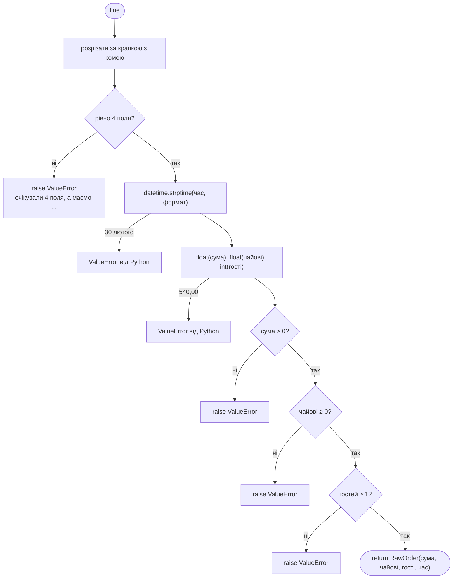

Зверни увагу: частину помилок Python піднімає **сам** — `float("540,00")` і `strptime` для 30 лютого вже дають `ValueError`. А правил кафе (сума > 0, гостей ≥ 1) Python не знає — їх перевіряєш ти і піднімаєш `raise ValueError(...)`.

**План.**

1. `fields = line.split(";")` і **одразу** перевір кількість. Якщо розпакувати 2 поля в 4 змінні, Python теж дасть `ValueError`, але з незрозумілим повідомленням `not enough values to unpack`. Своє пояснення краще.
2. Розпакуй 4 поля, перетвори час: формат `"%Y-%m-%d %H:%M"`.
3. Перетвори суму й чайові на `float`, гостей — на `int`.
4. Три правила кафе — три `if … raise ValueError(f"…")`. У повідомленні — що не так і яке значення прийшло.
5. `return RawOrder(...)` — у порядку полів `RawOrder`.
6. `python check.py 2`.

**Що перевіряють тести** (`tests/test_task2.py`):

- правильний рядок дає рівно такий `RawOrder`, і `total_bill` — саме `float`, а `size` — саме `int`;
- кома, 2 поля, 30 лютого, формат дати `19.07.2024` → `ValueError` з **непорожнім** повідомленням;
- сума `-120` і сума `0`, чайові `-5`, 0 гостей → `ValueError`.

**Типові помилки.**

- `return` у порядку рядка: `RawOrder(timestamp, bill, tip, size)` — тест покаже різницю.
- `size` як `float`: `float("2")` → `2.0`, а контракт хоче `int`.
- `if bill < 0` замість `<= 0` — пропустить чек на 0 грн.
- `try: … except: return None` всередині `parse_line` — функція «ковтає» помилку, і `load_orders` уже не дізнається, що рядок зіпсований.

**Пригадай.**

- [Урок 14, розділи 2 «Каса віддає рядки» і 5 «`raise`: правила кафе»](https://github.com/NikoriakViktot/PY-Course-Victor-Nikoriak-22-09-2026/blob/main/module_1/lessons/lesson_14_exceptions/note_lesson_14_exceptions_student.ipynb) — там `parse_line` будується крок за кроком · [книга](https://nikoriakviktot.github.io/PY-Course-Victor-Nikoriak-22-09-2026/modules/m1/lesson_14/)
- [Урок 5, розділ 4 — `NamedTuple`](https://github.com/NikoriakViktot/PY-Course-Victor-Nikoriak-22-09-2026/blob/main/module_1/lessons/lesson_05_lists_tuples_sets/note_lesson_05_lists_tuples_sets_student.ipynb)
- [Урок 13, розділ 8 — `datetime.strptime`](https://github.com/NikoriakViktot/PY-Course-Victor-Nikoriak-22-09-2026/blob/main/module_1/lessons/lesson_13_modules_stdlib/note_lesson_13_modules_stdlib_student.ipynb)

**Поглиблення (не обов'язково).** Повідомлення Python англійською (`could not convert string to float: '540,00'`) касир не зрозуміє. Можна зловити їх і підняти своє, українською, зберігши причину:

```python
try:
    bill = float(bill_text)
except ValueError as error:
    raise ValueError(f"сума має бути числом з крапкою, а маємо {bill_text!r}") from error
```

**Готово, коли:** `python check.py 2` → 3/3 `OK`.

---

### Задача 3 — `loading.py` — читання файлу і розбір усіх рядків

**Роль у проєкті.** Задача 2 вміє розібрати **один** рядок. Задача 3 — це конвеєр: прочитати файл, пропустити кожен рядок через `parse_line`, правильні чеки скласти в один список, а для зіпсованих записати, **який рядок** і **що з ним не так**.

**Чому важливо.** Тут вирішується головне: програма не падає на першому зіпсованому рядку. 4 правильні чеки потрапляють у звіт, а касир отримує `errors.txt` з номерами рядків, які треба виправити.

**Контракт.**

```python
read_lines("kasa.txt")          # файл: "перший\n\n  другий  \n\n"
# → ["перший", "другий"]         без порожніх рядків, без пробілів і \n по краях
read_lines("немає.txt")         # → FileNotFoundError (НЕ ловимо тут!)

load_orders(["a", "погано", "b"])
# → ([RawOrder_a, RawOrder_b], ["рядок 2: зіпсований рядок"])
load_orders([])                 # → ([], [])
```

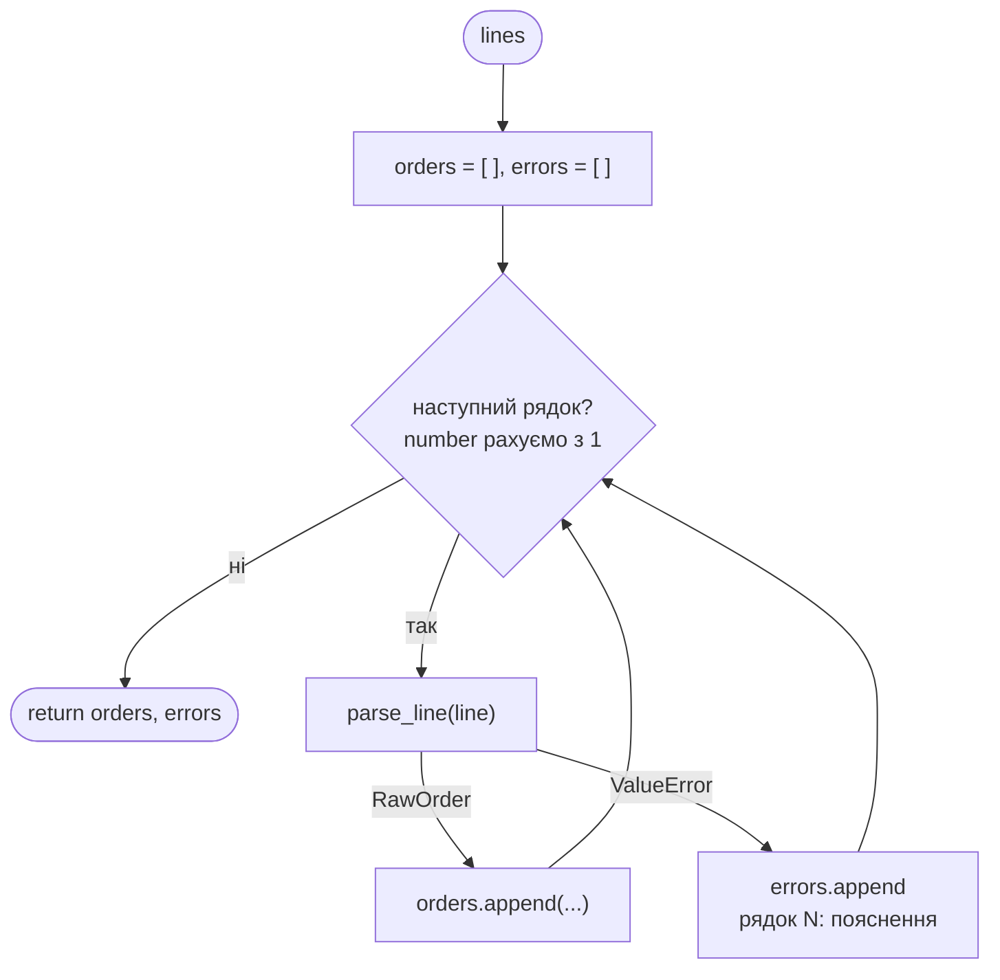

**План.**

1. `read_lines`: `with open(path, encoding="utf-8") as file:` → цикл по рядках → `line.strip()` → якщо не порожній, додати в список.
2. **Не** обгортай `open` у `try`. Що робити, коли файлу немає, знає лише `main.py`: він ловить `FileNotFoundError` і друкує «Немає файлу каси». Ловимо там, де знаємо, що відповісти.
3. `load_orders`: `for number, line in enumerate(lines, start=1):` → `try: orders.append(parse_line(line))` → `except ValueError as error: errors.append(f"рядок {number}: {error}")`.
4. `python check.py 3`.

**Що перевіряють тести** (`tests/test_task3.py`): порожні рядки й пробіли зникають; відсутній файл дає `FileNotFoundError`; порядок чеків зберігається; повідомлення рівно у форматі `"рядок 2: …"`; порожній список дає `([], [])`. `parse_line` тут замінена заглушкою, яка знає лише рядки `"a"` і `"b"`, — тому задачу 3 можна робити, поки задача 2 не готова.

**Типові помилки.**

- `except:` або `except Exception:` — «підгузок»: зловить і справжній баг у твоєму коді, і ти його не побачиш. Ловимо лише `ValueError`.
- Номери з 0: `enumerate(lines)` без `start=1` — касир шукатиме не той рядок.
- `"Рядок 2 - …"` замість `"рядок 2: …"` — інтеграційний тест читає номери до двокрапки.
- Переписати `parse_line` всередині `loading.py` замість `from parsing import parse_line` — заглушка не підставиться, а в проєкті з'являться дві різні версії розбору.
- `open(path)` без `encoding="utf-8"` — на Windows кирилиця прочитається неправильно.

**Пригадай.**

- [Урок 15, розділи 1 «Читаємо файл каси» і 4 «Шляхи і `FileNotFoundError`»](https://github.com/NikoriakViktot/PY-Course-Victor-Nikoriak-22-09-2026/blob/main/module_1/lessons/lesson_15_file_io_json/note_lesson_15_file_io_json_student.ipynb) · [книга](https://nikoriakviktot.github.io/PY-Course-Victor-Nikoriak-22-09-2026/modules/m1/lesson_15/)
- [Урок 14, розділи 3 «`try` / `except`», 6 «Де ловити» і 7 «Антипатерн „підгузок“»](https://github.com/NikoriakViktot/PY-Course-Victor-Nikoriak-22-09-2026/blob/main/module_1/lessons/lesson_14_exceptions/note_lesson_14_exceptions_student.ipynb) — там є `load_orders` з `enumerate`
- [Урок 6, розділ 7 — `for`](https://github.com/NikoriakViktot/PY-Course-Victor-Nikoriak-22-09-2026/blob/main/module_1/lessons/lesson_06_dicts_loops_comprehensions/note_lesson_06_dicts_loops_comprehensions_student.ipynb)

**Готово, коли:** `python check.py 3` → 3/3 `OK`.

---

### Задача 4 — `stats.py` — підрахунки за днями і прийомами їжі

**Роль у проєкті.** Тут з'являються цифри: скільки заробили в кожен день тижня, який день найкращий, скільки чеків на обід і на вечерю. День і прийом їжі **не** вираховуємо самі — питаємо в задачі 1.

**Чому важливо.** Це серце звіту. І найкраща ілюстрація роботи за контрактом: ти викликаєш `day_name`, яку, можливо, ще ніхто не написав, і все одно можеш перевірити свій код.

**Контракт.**

```python
revenue_by_day(orders)   # → {"пт": 860.0, "сб": 980.0}   лише дні, у які були чеки
revenue_by_day([])       # → {}
best_day({"пт": 860.0, "сб": 980.0, "нд": 100.0})   # → "сб"
best_day({})             # → None
count_by_meal(orders)    # → {"вечеря": 2, "обід": 1}
count_by_meal([])        # → {}
```

**Схема: патерн «підрахунок у словнику».** Той самий, що в уроці 6, лише ключ тепер дає функція з іншого модуля:

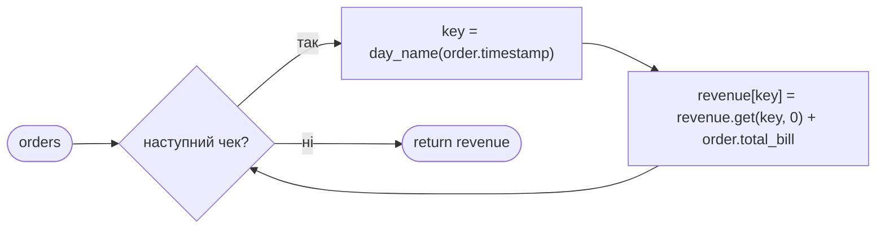

**Трасування** на даних з тесту — пройди його олівцем, перш ніж писати код:

| Крок | Чек | `day_name(...)` | `revenue` після кроку |
|---|---|---|---|
| старт | — | — | `{}` |
| чек 1 | 540.0, 19 липня 18:30 | `"пт"` | `{"пт": 540.0}` |
| чек 2 | 320.0, 19 липня 12:10 | `"пт"` | `{"пт": 860.0}` |
| чек 3 | 980.0, 20 липня 20:15 | `"сб"` | `{"пт": 860.0, "сб": 980.0}` |

`count_by_meal` — той самий цикл, але ключ `meal_type(order.timestamp.hour)` і додаємо `1`, а не суму. `best_day` — алгоритм «лідера»: пройти словник, пам'ятаючи найкращого на цей момент.

**План.**

1. `revenue_by_day` — цикл з трасування вище.
2. `count_by_meal` — той самий цикл, інший ключ і `+ 1`.
3. `best_day` — `best = None`, далі `for day, amount in revenue.items()` і заміна лідера, якщо `best is None` або сума більша. Порожній словник → цикл не виконається жодного разу → `None`.
4. `python check.py 4`.

**Що перевіряють тести** (`tests/test_task4.py`): результати на трьох чеках і на порожньому списку; `best_day` на трьох днях і на порожньому словнику. `day_name` і `meal_type` замінено заглушками.

**Типові помилки.**

- Порахувати день самому: `DAYS[order.timestamp.weekday()]` прямо в `stats.py`. Тести можуть пройти, але правило дня тепер живе у двох місцях. Викликай `day_name` — для цього вона й існує.
- `meal_type(order.timestamp)` замість `meal_type(order.timestamp.hour)` — контракт задачі 1 приймає **годину**, а не `datetime`.
- `max(revenue, key=revenue.get)` на порожньому словнику → `ValueError`. Якщо хочеш `max`, додай `default=None`.
- Округлювати тут не потрібно. Округлює звіт (задача 5).

**Пригадай.**

- [Урок 6 — патерн Counting, «Leader algorithm: який день найприбутковіший?», `.get()`](https://github.com/NikoriakViktot/PY-Course-Victor-Nikoriak-22-09-2026/blob/main/module_1/lessons/lesson_06_dicts_loops_comprehensions/note_lesson_06_dicts_loops_comprehensions_student.ipynb) · [книга](https://nikoriakviktot.github.io/PY-Course-Victor-Nikoriak-22-09-2026/modules/m1/lesson_06/)
- [Урок 8 — функції `revenue_by_day` і `best_day` у звіті кафе](https://github.com/NikoriakViktot/PY-Course-Victor-Nikoriak-22-09-2026/blob/main/module_1/lessons/lesson_08_functions/note_lesson_08_functions_student.ipynb) · [книга](https://nikoriakviktot.github.io/PY-Course-Victor-Nikoriak-22-09-2026/modules/m1/lesson_08/)
- [Урок 16, вправа 2](https://github.com/NikoriakViktot/PY-Course-Victor-Nikoriak-22-09-2026/blob/main/module_1/lessons/lesson_16_git_github_system/note_lesson_16_git_github_system_student.ipynb) — ти вже писав цю задачу в навчальному репозиторії.

**Готово, коли:** `python check.py 4` → 3/3 `OK`.

---

### Задача 5 — `report.py` — словник звіту

**Роль у проєкті.** Збирає всі цифри в **один словник** з чітко визначеними ключами. Цей словник — спільна мова між задачами 5 і 6: задача 6 його друкує і зберігає в JSON і розраховує рівно на ці ключі.

**Чому важливо.** Найбільш «контрактна» задача. Якщо ключ називається не так або значення не того типу, усі окремі тести можуть бути зелені, а інтеграційний впаде. Тому ключі, порядок і типи тут — частина завдання, а не дрібниці.

**Контракт** (ключі рівно ці):

| Ключ | Значення | Звідки |
|---|---|---|
| `"orders"` | кількість чеків, `int` | `len(orders)` |
| `"skipped"` | кількість помилок, `int` | `len(errors)` |
| `"revenue"` | сума всіх чеків, `round(…, 2)` | сума `total_bill` |
| `"average"` | середній чек, `round(…, 2)`; `0.0`, якщо чеків немає | виторг / кількість |
| `"best_day"` | день або `None` | `best_day(...)` з задачі 4 |
| `"by_day"` | `{день: виторг}`, **у порядку `DAYS`**, лише дні з чеками | `revenue_by_day(...)` з задачі 4 |
| `"by_meal"` | `{прийом: кількість}`, **від більшого до меншого** | `count_by_meal(...)` з задачі 4 |
| `"first_order"` | час **найранішого** чека рядком `isoformat()` або `None` | `min` по `timestamp` |

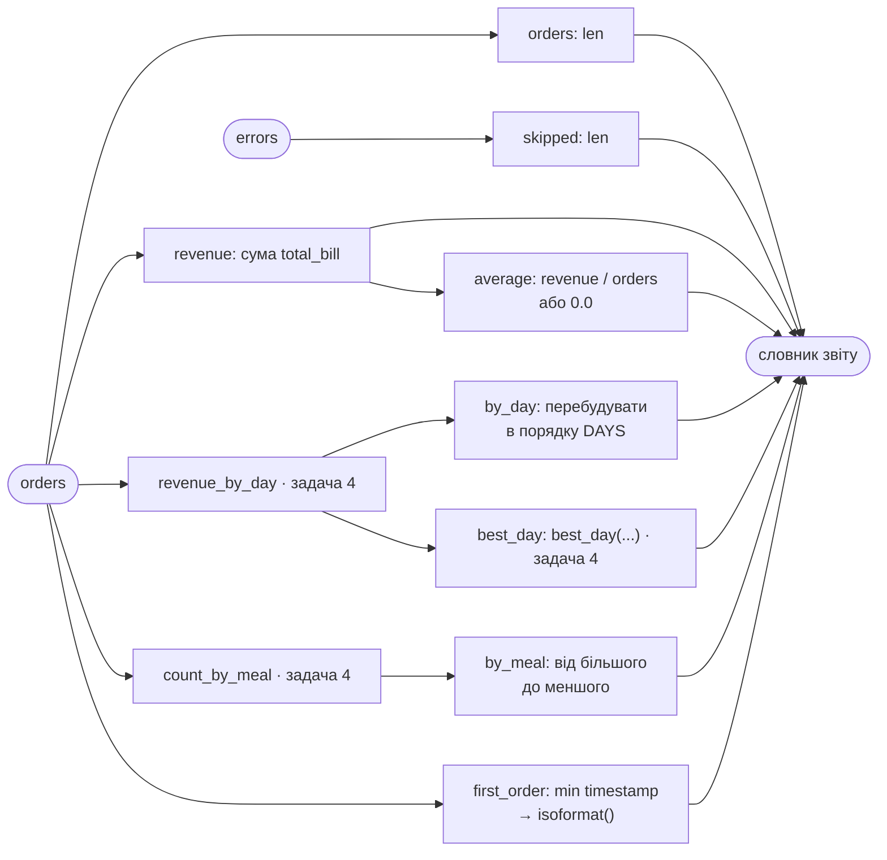

**План.**

1. Порахуй `revenue` і середній чек. Порожній список чеків → ділення на нуль, тому `if orders else 0.0`.
2. Виклич `revenue_by_day`, `best_day`, `count_by_meal` — **за тими іменами**, що імпортовано вгорі файлу (тести підмінюють саме їх).
3. `by_day` — новий словник: пройти по `DAYS` і взяти лише дні, які є в результаті `revenue_by_day`. Dict comprehension тут якраз доречний.
4. `by_meal` — упорядкуй від більшого до меншого. Готовий інструмент уже імпортовано: `Counter(...).most_common()` повертає пари в потрібному порядку, а `dict(...)` робить з них словник.
5. `first_order` — `min(...)` по часу чеків, потім `.isoformat()`. Без чеків → `None`.
6. Переконайся, що в словнику **лише типи JSON**: `int`, `float`, `str`, `None`, `dict`. Ніяких `datetime`, кортежів чи `Counter`.
7. `python check.py 5`.

**Що перевіряють тести** (`tests/test_task5.py`) — і тут є навмисні пастки:

- заглушка `revenue_by_day` повертає дні **не в порядку тижня** (`нд`, потім `пт`) — ти маєш упорядкувати;
- заглушка `count_by_meal` повертає **від меншого до більшого** — ти маєш перевернути;
- **перший** чек у списку — 21 липня, а найраніший — 19 липня 12:10. `orders[0]` дасть неправильну відповідь;
- середній чек `2060 / 3 = 686.666…` → має бути `686.67`;
- `json.dumps(result)` не повинен впасти;
- порожні `orders` і `errors` → нулі, `None` і порожні словники, без `ZeroDivisionError`.

**Типові помилки.**

- `"first_order": orders[0].timestamp` — не той чек, та ще й `datetime`, який JSON не збереже.
- `"by_meal": Counter(...)` — виглядає як словник, але тест хоче звичайний `dict` у правильному порядку.
- Переписати підрахунки задачі 4 тут замість виклику її функцій.
- Інші назви ключів: `"count"`, `"total"`, `"by_time"` (як в уроці 15). Тут контракт свій — дивись докстрінг.

**Пригадай.**

- [Урок 15, розділи 5 «JSON» («Що JSON вміє, а що ні») і 8 «Розібраний приклад: місячний звіт»](https://github.com/NikoriakViktot/PY-Course-Victor-Nikoriak-22-09-2026/blob/main/module_1/lessons/lesson_15_file_io_json/note_lesson_15_file_io_json_student.ipynb) — там дуже схожа `build_report` · [книга](https://nikoriakviktot.github.io/PY-Course-Victor-Nikoriak-22-09-2026/modules/m1/lesson_15/)
- [Урок 6, розділ 9 — dict comprehension; `Counter`](https://github.com/NikoriakViktot/PY-Course-Victor-Nikoriak-22-09-2026/blob/main/module_1/lessons/lesson_06_dicts_loops_comprehensions/note_lesson_06_dicts_loops_comprehensions_student.ipynb)
- [Урок 13, розділ 8 — `collections.Counter`](https://github.com/NikoriakViktot/PY-Course-Victor-Nikoriak-22-09-2026/blob/main/module_1/lessons/lesson_13_modules_stdlib/note_lesson_13_modules_stdlib_student.ipynb)

**Готово, коли:** `python check.py 5` → 2/2 `OK`.

---

### Задача 6 — `output.py` — JSON і текст звіту

**Роль у проєкті.** Звіт готовий, але поки що це словник у пам'яті. Задача 6 робить з нього дві речі: **файл** `report.json` для сайту кафе чи бухгалтера і **текст** для людини на екрані.

**Чому важливо.** Це те, що реально побачить власниця. І це єдина задача, яка не імпортує нікого з команди, але повністю залежить від **формату** словника задачі 5. Добрий приклад того, що контракт — це не лише функції, а й дані.

**Контракт.**

- `save_json(report, path)` — записує словник у файл: кирилиця як є (`ensure_ascii=False`), відступ 2 пробіли (`indent=2`). Нічого не повертає.
- `format_report(report)` — повертає **рядок** з п'яти рядків, з'єднаних `"\n"`, **без** `"\n"` у кінці (`main.py` друкує його через `print`, який сам додасть перенесення).

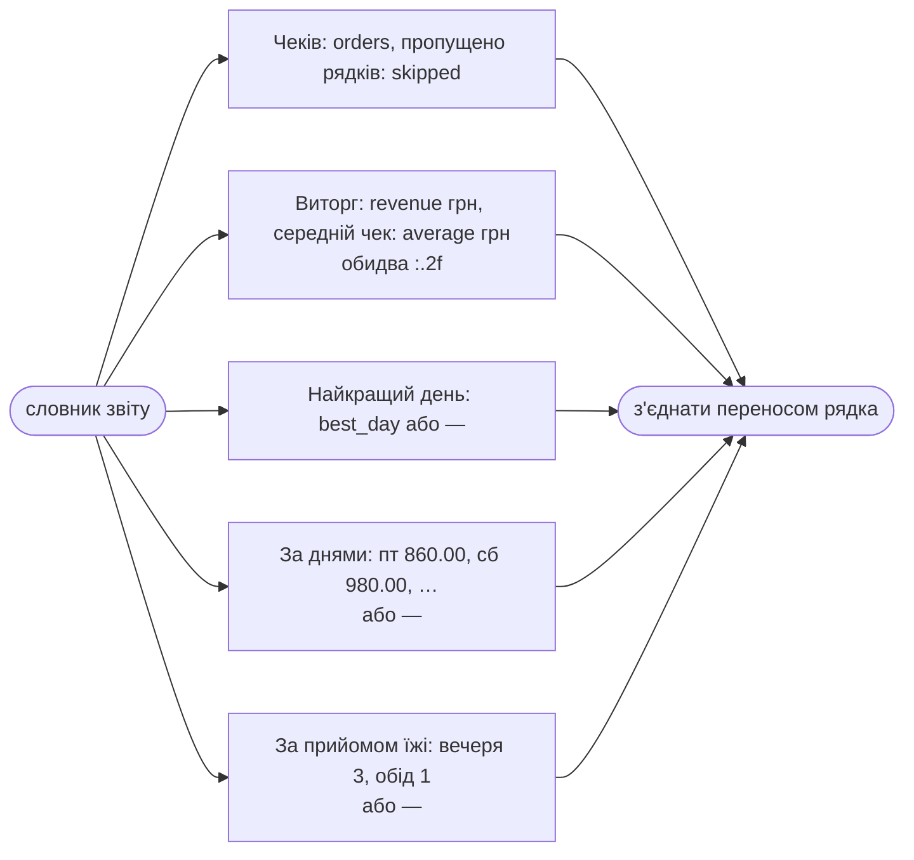

Порожній звіт (`best_day` — `None`, `by_day` і `by_meal` — `{}`):

```text
Чеків: 0, пропущено рядків: 2
Виторг: 0.00 грн, середній чек: 0.00 грн
Найкращий день: —
За днями: —
За прийомом їжі: —
```

**План.**

1. `save_json`: `with open(path, "w", encoding="utf-8") as file:` і `json.dump(report, file, ensure_ascii=False, indent=2)`.
2. `format_report`: спершу збери два рядки-переліки: `", ".join(f"{day} {amount:.2f}" for …)` по `report["by_day"].items()` і так само для `by_meal` (там кількість — ціле число, без `.2f`).
3. Порожній перелік → `""` → заміни на `"—"`. Те саме для `best_day`, якщо він `None`. Коротко: `value or "—"`.
4. П'ять f-рядків у список → `"\n".join(...)`.
5. `python check.py 6`.

**Що перевіряють тести** (`tests/test_task6.py`): `report.json` читається назад у той самий словник; у файлі є `"нд"` кирилицею, а не `"нд"`; є відступ 2; текст звіту збігається **символ у символ** — і для повного, і для порожнього звіту.

**Типові помилки.**

- `print` всередині `format_report` замість `return` — тест отримає `None`.
- `"\n"` у кінці тексту — у виводі `main.py` з'явиться зайвий порожній рядок.
- Дефіс `-` або `–` замість довгого тире `—`. Скопіюй символ з докстрінга.
- `f"{amount}"` без `:.2f` — надрукує `860.0` замість `860.00`.
- Змінювати `report` всередині функції (наприклад, `report["best_day"] = "—"`) — тоді `save_json` збереже `"—"` замість `null`.

**Пригадай.**

- [Урок 15, розділ 5 «JSON», розділ 8 і шпаргалка: `json.dump`, `ensure_ascii`, `indent`, `:.2f`](https://github.com/NikoriakViktot/PY-Course-Victor-Nikoriak-22-09-2026/blob/main/module_1/lessons/lesson_15_file_io_json/note_lesson_15_file_io_json_student.ipynb) · [книга](https://nikoriakviktot.github.io/PY-Course-Victor-Nikoriak-22-09-2026/modules/m1/lesson_15/)
- [Урок 6, розділ 3 — ітерація по словнику, `.items()`; розділ 8 — comprehensions](https://github.com/NikoriakViktot/PY-Course-Victor-Nikoriak-22-09-2026/blob/main/module_1/lessons/lesson_06_dicts_loops_comprehensions/note_lesson_06_dicts_loops_comprehensions_student.ipynb)
- [Урок 8, розділ 2 — `return` vs `print`](https://github.com/NikoriakViktot/PY-Course-Victor-Nikoriak-22-09-2026/blob/main/module_1/lessons/lesson_08_functions/note_lesson_08_functions_student.ipynb)

**Готово, коли:** `python check.py 6` → 3/3 `OK`.

---

## 6. Коли щось пішло не так

### GitHub пише «This branch has conflicts that must be resolved»

Найчастіше — у `TEAM.md`: ти і хтось інший дописали рядок у кінець файлу. Розв'язує **автор PR** у своїй гілці:

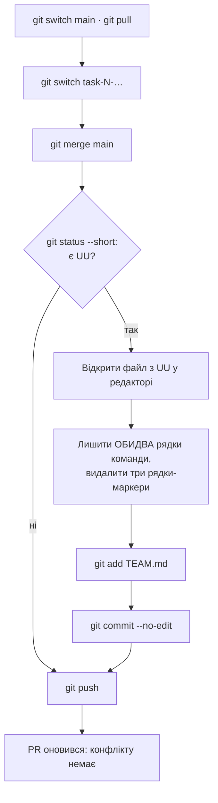

Маркери конфлікту — це три службові рядки, які вставив Git: сім знаків `<` з назвою гілки, сім знаків `=` і сім знаків `>`. Між ними — твоя версія і версія з `main`. Потрібно залишити обидва рядки таблиці (у порядку номерів задач) і видалити всі три маркери. Як це виглядає — [урок 16, розділ 5 «Конфлікт» і вправа 3](https://github.com/NikoriakViktot/PY-Course-Victor-Nikoriak-22-09-2026/blob/main/module_1/lessons/lesson_16_git_github_system/note_lesson_16_git_github_system_student.ipynb).

Злякався посеред злиття? `git merge --abort` повертає все, як було до `git merge main`.

### Інші типові ситуації

| Ситуація | Що зробити |
|---|---|
| `git push` → `rejected … fetch first` | Хтось уже запушив у цю гілку. `git pull`, потім знову `git push`. |
| `git push` → `Permission denied` | Не прийнято запрошення в Collaborators. Перевір пошту / сповіщення GitHub. |
| Закомітив у `main` замість своєї гілки (ще не запушив) | `git switch -c task-N-…` — гілка створиться з цим комітом. Потім `git switch main` і `git reset --hard origin/main`, щоб `main` знову збігався з GitHub. |
| `git status` показує чужі файли або `__pycache__/` | Не додавай їх: `git add` лише двох своїх файлів. `__pycache__/` має ігнорувати `.gitignore` — перевір `git check-ignore -v __pycache__`. |
| У коміт потрапив `report.json` | `git rm --cached report.json` і коміт — [урок 16, вправа 4](https://github.com/NikoriakViktot/PY-Course-Victor-Nikoriak-22-09-2026/blob/main/module_1/lessons/lesson_16_git_github_system/note_lesson_16_git_github_system_student.ipynb). |
| `check.py N` пише `ще не зроблено` для **чужої** функції | У тебе стара версія тестів. `git pull` у `main` і `git merge main` у свою гілку. |
| Окремо все `OK`, а `check.py all` — ❌ | Хтось розійшовся з контрактом. Читай повідомлення: там файл і рядок. Виправлення — у новій гілці `fix-…` і через PR. |
| `ModuleNotFoundError: No module named 'models'` | Запускаєш не з кореня проєкту. `cd` туди, де лежить `check.py`. |
| `python: command not found` | Спробуй `python3`. На Windows — перевстанови Python з галочкою «Add to PATH». |

---

## 7. Перевір себе

1. Чому задачу 5 можна зробити й перевірити, коли задача 4 ще не злита?
2. Усі шість PR злилися без конфліктів. Чи означає це, що проєкт працює? Як це перевірити?
3. Чому `parse_line` не повинна сама ловити свої `ValueError`, а `read_lines` — свій `FileNotFoundError`?
4. Чому в `build_report` для `first_order` не можна взяти `orders[0]`?
5. Чому `rules.py`, `stats.py` та інші `.py` злилися самі, а `TEAM.md` конфліктував?
6. Навіщо рецензенту запускати `python check.py N` у себе, якщо автор PR каже, що в нього все `OK`?

<details>
<summary>Відповіді</summary>

1. Тести задачі 5 підставляють заглушки замість `revenue_by_day`, `best_day` і `count_by_meal`, які повертають те, що обіцяє контракт. Задача 5 спирається на контракт, а не на чужий код.
2. Ні. Git порівнює текст, а не сенс. Перевіряє `python check.py all` — інтеграційний тест запускає `main.py` на справжньому файлі каси.
3. Ловимо там, де знаємо, що відповісти. `parse_line` не знає, що робити із зіпсованим рядком, — це знає `load_orders` (записати в помилки). `read_lines` не знає, що робити без файлу, — це знає `main.py` (повідомити користувача).
4. Чеки у файлі не впорядковані за часом: у `kasa_2024_07.txt` рядок 2 (12:10) раніший за рядок 1 (18:30). Потрібен `min` по `timestamp`. А ще `datetime` треба перетворити на рядок `isoformat()`, бо JSON його не збереже.
5. Кожен `.py` змінювала лише одна гілка. `TEAM.md` змінювали всі, і всі — в одному місці, у кінці файлу.
6. «У мене працює» могло залежати від файлів, які автор забув закомітити, або від старого `main`. Рецензент перевіряє саме те, що лежить у гілці на GitHub.

</details>

---

## 8. Команда

Кожен у своїй гілці дописує **один** рядок у кінець цієї таблиці: номер задачі, файл, ім'я. Наприклад, для задачі 3: `| 3 | loading.py | Твоє ім'я |`.

| Задача | Файл | Хто |
|---|---|---|
