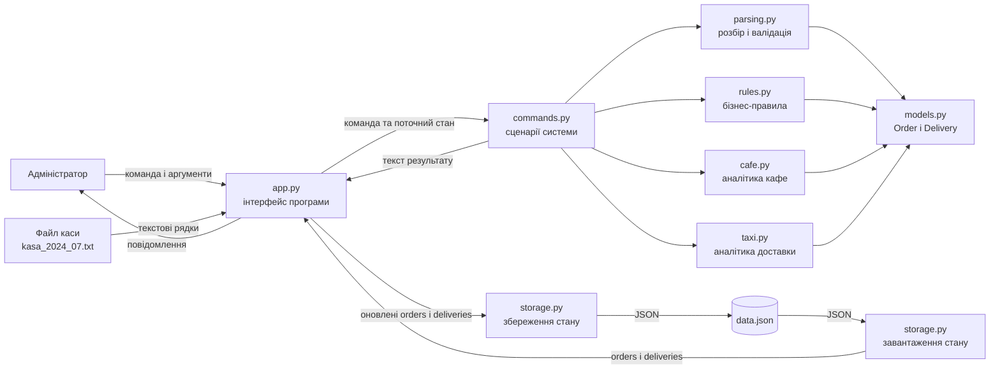
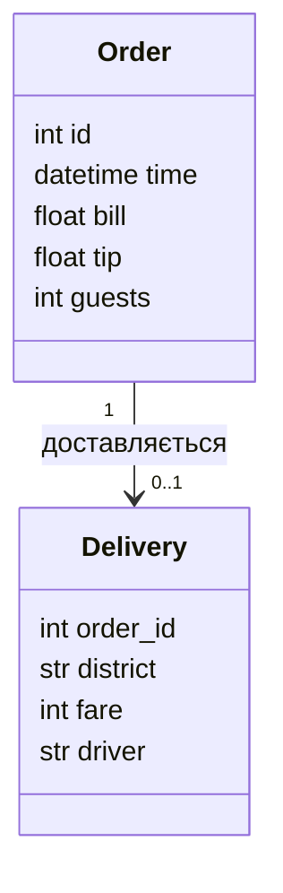
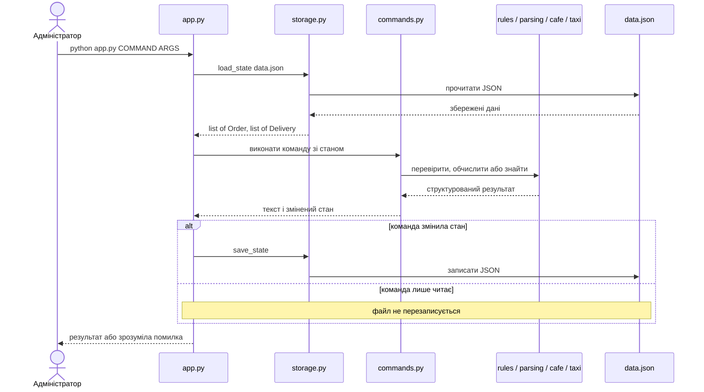
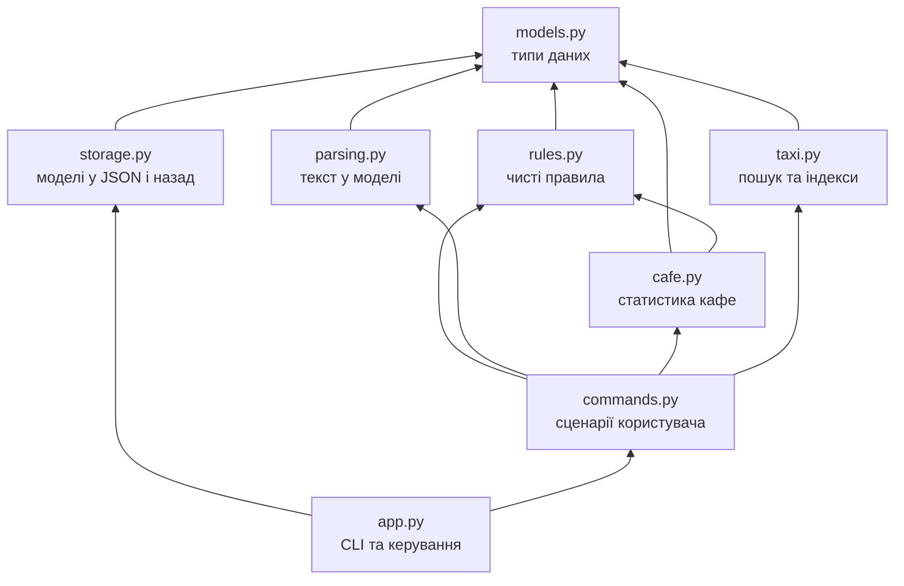
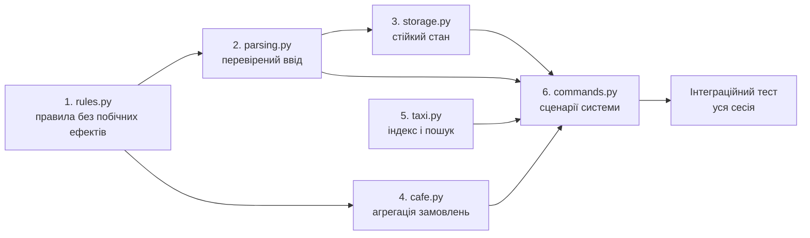
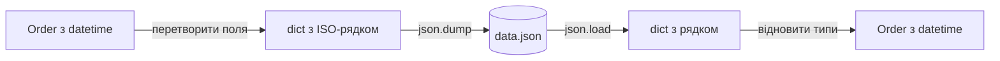
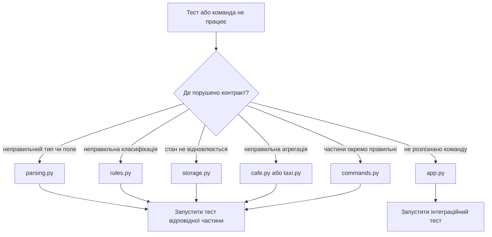

# «Смачно + Таксі» — підсумковий проєкт модуля 1

Весна 2020 року. Через карантин зал кафе «Смачно» зачинений, а в таксі майже немає пасажирів. Кафе продовжує готувати, водії таксі доставляють замовлення. Потрібна одна консольна програма, яка:

- приймає та імпортує замовлення кафе;
- реєструє доставки;
- знаходить замовлення за номером;
- рахує статистику кафе й таксі;
- шукає дві доставки на задану суму ваучера;
- зберігає стан у `data.json`, щоб дані не зникали після перезапуску.

Це не просто велика вправа на синтаксис. Мета проєкту — навчитися бачити програму як **систему**: визначати її межі, моделювати дані, розділяти відповідальність, проєктувати потік інформації та будувати частини у правильному порядку.

> Головне питання уроку: не «який рядок коду написати?», а «яка частина системи повинна виконувати цю роботу, які дані вона отримує і що гарантує на виході?»

## 1. Спочатку проєктуємо систему

Перш ніж відкривати файли із `NotImplementedError`, розгляньте схеми. Вони показують, **що від чого залежить** і **як дані проходять через програму**.

### 1.1. Межі системи та головний потік даних



Система має дві зовнішні межі:

1. **Людина та файл каси** передають ненадійний текст. Його ще не можна вважати правильними даними.
2. **Файл `data.json`** зберігає стан між запусками, але його вміст також може бути відсутнім або пошкодженим.

Усередині програми ми працюємо не з випадковими рядками, а з об'єктами `Order` і `Delivery`. Перехід від зовнішнього тексту до внутрішніх типізованих даних — відповідальність `parsing.py` і `storage.py`.

### 1.2. Модель даних



`Order.id` — унікальний номер замовлення. `Delivery.order_id` посилається на цей номер. Звідси випливають системні правила, або **інваріанти**:

- номер кожного замовлення унікальний;
- доставка не може існувати без відповідного замовлення;
- одне замовлення має не більше однієї доставки;
- `bill > 0`, `tip >= 0`, `guests >= 1`, `fare > 0`;
- після `save_state()` і наступного `load_state()` дані мають відновитися без змін.

Інваріант — це твердження, яке повинно залишатися істинним у будь-який момент роботи правильної програми.

### 1.3. Життєвий цикл однієї команди



Зверніть увагу: `find`, `report` і `voucher` лише читають стан. `add-order`, `import` та `add-delivery` змінюють його, тому після них `app.py` викликає `save_state()`.

### 1.4. Залежності модулів



Стрілка означає «верхня частина використовує нижню». Тому `commands.py` не можна надійно завершити раніше за модулі, які він викликає.

### 1.5. Правильний порядок реалізації



Частини 3, 4 і 5 можна розробляти паралельно після базових контрактів, але частина 6 з'єднує їх усі. Інтеграційна перевірка має сенс лише тоді, коли окремі частини вже працюють.

## 2. Що з модуля 1 тут стало потрібним

| Урок | Вивчена тема | Де застосовуємо у capstone | Навіщо це системі |
|---:|---|---|---|
| 1 | Формат курсу й декомпозиція навчання | рухаємося малими перевірюваними частинами | Керуємо складністю замість спроби написати все одразу |
| 2 | Середовище, запуск Python і командний рядок | запускаємо `app.py` та `check.py`, передаємо аргументи | Розуміємо, як користувач входить у систему |
| 3 | Змінні, базові типи, рядки й форматування | `id`, `bill`, `tip`, `guests`, `fare`, дати та повідомлення | Представляємо факти предметної області правильними типами |
| 4 | Умови, булева логіка та цикли | межі часу, перевірки, імпорт і формування звіту | Реалізуємо правила та обробляємо колекції |
| 5 | `list`, `tuple`, `set` | списки стану, `NamedTuple`, множина номерів | Обираємо структуру відповідно до способу використання |
| 6 | `dict`, цикли й comprehensions | індекси за `id`, суми за днями, серіалізація | Швидко знаходимо дані й будуємо нові структури |
| 8 | Функції | кожна операція має вхід, результат і одну відповідальність | Ділимо систему на перевірювані частини |
| 9 | Big O | `delivery_index`, `voucher_pair`, пошук за словником | Оцінюємо поведінку рішення на великих даних |
| 10 | Декоратори | прямо не потрібні в обов'язковій частині | Розуміємо, що не кожну вивчену конструкцію треба вставляти в проєкт |
| 11 | Ітератори та генератори | `sum(...)`, генераторні вирази, один прохід у Two Sum | Не створюємо зайві проміжні списки |
| 12 | Практикум пошуку | `find_order`, пошук доставки, Two Sum | Обираємо лінійний пошук або індекс залежно від задачі |
| 13 | Модулі та стандартна бібліотека | `datetime`, `json`, `collections.Counter`, власні імпорти | Не пишемо все в одному файлі та повторно використовуємо інструменти |
| 14 | Винятки | `ValueError`, `FileNotFoundError`, `JSONDecodeError` | Помилки стають частиною контракту, а не аварією програми |
| 15 | Файли та JSON | імпорт каси, `data.json` | Дані переживають завершення процесу Python |
| 16 | Git і GitHub | гілка на частину, коміти, Pull Request | Інтегруємо зміни контрольовано й бачимо історію рішень |
| 17 | Хешування | словники й множини для індексів | Отримуємо пошук у середньому за `O(1)` замість повторних проходів |

Важливий інженерний висновок: хороший код використовує не найбільшу кількість вивчених конструкцій, а **найпростіші конструкції, які правильно розв'язують задачу**.

## 3. Архітектурні ролі файлів

| Файл | Роль | Може знати про | Не повинен робити |
|---|---|---|---|
| `models.py` | опис внутрішніх типів `Order`, `Delivery` і `DAYS` | базові типи, `datetime`, `NamedTuple` | читати файли, друкувати, рахувати звіти |
| `rules.py` | прості правила предметної області | `models.py` | змінювати стан, працювати з CLI або JSON |
| `parsing.py` | перетворення зовнішнього тексту на моделі | `models.py`, `datetime` | додавати об'єкти до глобального стану |
| `storage.py` | серіалізація і відновлення стану | `models.py`, `json`, `datetime` | виконувати бізнес-команди |
| `cafe.py` | агрегована статистика замовлень | `models.py`, `rules.py`, `Counter` | форматувати весь консольний звіт |
| `taxi.py` | індекс, рейтинг районів, пошук пари | `Delivery`, `Counter`, `dict` | знати про аргументи командного рядка |
| `commands.py` | прикладні сценарії та узгодження кафе з таксі | `rules`, `parsing`, `cafe`, `taxi` | читати `sys.argv`, друкувати, напряму читати JSON |
| `app.py` | зовнішній інтерфейс і життєвий цикл команди | `commands.py`, `storage.py`, `sys` | дублювати бізнес-правила |
| `check.py`, `tests/` | автоматична перевірка контрактів | публічні функції системи | змінювати робочі дані користувача |

Такий поділ називається **розділенням відповідальності**. Якщо формат JSON зміниться, ми очікуємо правки в `storage.py`, а не в усіх файлах. Якщо зміниться правило обіду — у `rules.py`, а не в `report()`.

## 4. Контракти функцій і типи даних

Точні приклади та формулювання помилок наведені в докстрінгах і тестах. Нижче — карта публічних контрактів.

### `rules.py`

| Функція | Вхід | Вихід | Метод |
|---|---|---|---|
| `meal_type(hour)` | `int` | `str` | послідовні перевірки діапазонів |
| `day_name(time)` | `datetime` | `str` | `weekday()` як індекс у `DAYS` |

Ці функції чисті: однаковий вхід завжди дає однаковий вихід, стан системи не змінюється.

### `parsing.py`

| Функція | Вхід | Вихід | Помилка |
|---|---|---|---|
| `parse_order(line, order_id)` | `str`, `int` | `Order` | `ValueError`, якщо структура, дата або значення неправильні |
| `parse_delivery(fields)` | `list[str]` | `Delivery` | `ValueError`, якщо полів не чотири або порушено правила |

Парсер працює як шлюз:

```text
ненадійний текст → розділення полів → перетворення типів → перевірка правил → модель
```

Не створюйте `Order` до завершення всіх перевірок. Або функція повертає повністю валідний об'єкт, або піднімає `ValueError`.

### `storage.py`

| Функція | Вхід | Вихід | Побічний ефект |
|---|---|---|---|
| `save_state(path, orders, deliveries)` | шлях, `list[Order]`, `list[Delivery]` | `None` | записує JSON-файл |
| `load_state(path)` | шлях | `tuple[list[Order], list[Delivery]]` | читає JSON-файл |

Об'єкт `datetime` не є безпосередньо JSON-сумісним, тому при записі стає ISO-рядком, а при читанні відновлюється назад у `datetime`.



### `cafe.py`

| Функція | Вхід | Вихід | Метод |
|---|---|---|---|
| `cafe_stats(orders)` | `list[Order]` | `dict` зі статистикою | один або кілька зрозумілих проходів, `sum`, `Counter`, словник сум за днями |

Потрібно отримати кількість, виторг, середній чек, найкращий день і розподіл за прийомами їжі. Окремо продумайте порожній список: ділення на нуль неможливе, а найкращого дня немає.

### `taxi.py`

| Функція | Вхід | Вихід | Метод і складність |
|---|---|---|---|
| `delivery_index(deliveries)` | `list[Delivery]` | `dict[int, Delivery]` | dict comprehension, побудова `O(n)`, пошук `O(1)` у середньому |
| `top_districts(deliveries, k=3)` | список і `int` | `list[tuple[str, int]]` | `Counter.most_common(k)`, `O(n)` для підрахунку |
| `voucher_pair(deliveries, amount)` | список і `int` | `tuple[int, int]` або `None` | Two Sum зі словником, час `O(n)`, пам'ять `O(n)` |

Для `voucher_pair` не перебирайте всі пари подвійним циклом `O(n²)`. На кожному кроці обчисліть, якої суми бракує, і перевірте її у словнику вже побачених тарифів.

### `commands.py`

| Функція | Головна відповідальність | Змінює стан |
|---|---|---|
| `next_id` | знайти наступний унікальний номер | ні |
| `add_order` | розібрати один рядок і додати замовлення | `orders` |
| `import_kasa` | додати всі валідні рядки, зібрати помилки невалідних | `orders` |
| `add_delivery` | перевірити зв'язок і додати доставку | `deliveries` |
| `find_order` | знайти замовлення та пов'язану доставку | ні |
| `report` | об'єднати статистику кафе і таксі | ні |
| `voucher` | представити результат `voucher_pair` людині | ні |

Командний шар не повинен повторно реалізовувати парсинг, статистику або Two Sum. Він **компонує** вже готові функції.

## 5. Покроковий план реалізації

### Крок 0. Прочитайте систему, не пишіть код

1. Запустіть `python check.py`.
2. Відкрийте `models.py`, докстрінги незавершених функцій і відповідні тести.
3. Для кожної функції письмово визначте вхід, вихід, помилки та побічні ефекти.
4. Намалюйте на папері один приклад проходження даних від команди до результату.

**Чому:** код без контракту легко зробити таким, що «працює на моєму прикладі», але не поєднується з рештою системи.

### Крок 1. Реалізуйте `rules.py`

Завдання:

- реалізувати межі «обіду», «вечері» та «іншого»;
- отримати назву дня через `datetime.weekday()` і `DAYS`;
- перевірити граничні години: `10`, `11`, `15`, `16`, `17`, `23`.

**Чому спочатку:** це найнижчий і найпростіший шар. Він не залежить від інших незавершених частин, зате `cafe.py` і `commands.py` залежать від нього.

Перевірка:

```bash
python check.py 1
```

### Крок 2. Реалізуйте `parsing.py`

Для кожного парсера дотримуйтеся однакової послідовності:

1. Перевірити кількість полів.
2. Прибрати зайві пробіли там, де це передбачено контрактом.
3. Перетворити текст у `datetime`, `int` або `float`.
4. Перевірити смислові обмеження.
5. Лише після цього створити `Order` або `Delivery`.

**Чому:** після парсера інші модулі можуть довіряти типам та інваріантам і не повторювати однакові перевірки.

Не перехоплюйте `ValueError`, якщо не можете додати корисний контекст. Помилка повинна дійти до `app.py`, де її буде перетворено на повідомлення користувачу.

```bash
python check.py 2
```

### Крок 3. Реалізуйте `storage.py`

Завдання:

- перетворити об'єкти моделей на словники, сумісні з JSON;
- записати `orders` і `deliveries` в одному кореневому словнику;
- зберегти кирилицю через `ensure_ascii=False`;
- на першому запуску повернути два порожні списки;
- перетворити прочитані словники назад на `Order` і `Delivery`;
- пояснити пошкоджений JSON через `ValueError`.

**Чому зараз:** до побудови команд нам потрібен надійний механізм відновлення стану. Це окрема технічна відповідальність, яку можна перевірити незалежно.

Ключова властивість — **round trip**:

```text
початковий стан == load_state(save_state(початковий стан))
```

```bash
python check.py 3
```

### Крок 4. Реалізуйте `cafe.py`

Спочатку випишіть, які проміжні дані потрібні:

- загальний виторг;
- виторг за кожним днем;
- кількість замовлень за типом прийому їжі.

Потім побудуйте результат із фіксованими ключами контракту. Для вибору найкращого дня використайте порядок `DAYS`, щоб результат був передбачуваним навіть за однакового виторгу.

**Чому після `rules.py`:** статистика використовує `day_name()` і `meal_type()`. Якщо правило класифікації неправильне, аналітика теж буде неправильною.

```bash
python check.py 4
```

### Крок 5. Реалізуйте `taxi.py`

Тут потрібно свідомо обрати структури даних:

- `dict[order_id, Delivery]` — коли ключем пошуку є номер замовлення;
- `Counter` — коли потрібно порахувати повторення районів;
- `dict[fare, order_id]` — коли треба пам'ятати вже побачені тарифи для Two Sum.

**Чому:** структура даних визначає алгоритм. Словник потрібен не «бо ми його вчили», а тому що він прибирає повторний лінійний пошук.

```bash
python check.py 5
```

### Крок 6. Реалізуйте `commands.py`

Реалізуйте сценарії від простіших до складніших:

1. `next_id`;
2. `add_order`;
3. `import_kasa`;
4. `add_delivery`;
5. `find_order`;
6. `report`;
7. `voucher`.

Для кожної команди використовуйте цикл мислення:

```text
отримати аргументи → викликати готові нижні функції →
перевірити системні інваріанти → за потреби змінити список →
повернути текст
```

Особливо важливо:

- `import_kasa` не зупиняє весь імпорт через один поганий рядок, а накопичує помилки;
- `add_delivery` спершу перевіряє існування замовлення та відсутність попередньої доставки;
- `find_order` будує індекси, а потім знаходить пов'язані дані;
- `report` використовує `cafe_stats()` і `top_districts()`, а не дублює їх;
- жодна команда не викликає `print()` — вона повертає рядок.

**Чому останньою:** це прикладний шар, який з'єднує всі попередні рішення. Якщо нижні контракти стабільні, тут залишається композиція, а не хаотичне виправлення всього одразу.

```bash
python check.py 6
```

### Крок 7. Перевірте систему як одне ціле

```bash
python check.py all
```

Окремі тести доводять, що деталі працюють ізольовано. Інтеграційний тест доводить, що вони правильно взаємодіють у реальній послідовності команд і що стан переживає перезапуск.

Після тестів виконайте коротку ручну сесію:

```bash
python app.py import kasa_2024_07.txt
python app.py add-order "2024-07-22 12:40;310.00;20;1"
python app.py add-delivery 1 Оболонь 230 D-3
python app.py find 1
python app.py report
python app.py voucher 500
```

## 6. Як читати помилку системно

Не виправляйте перший рядок, що трапився. Спочатку визначте шар помилки.



Корисні запитання під час налагодження:

- Яке фактичне значення і який його тип?
- На якій межі текст мав перетворитися на модель?
- Який інваріант порушено?
- Чи змінює ця функція стан, хоча не повинна?
- Помилка локальна чи з'являється лише при з'єднанні модулів?
- Чи перевірив я порожній список, межі діапазону та невалідний ввід?

## 7. Критерії готовності

### Функціональність

- усі шість частин реалізовано;
- `python check.py all` завершується повідомленням `✅ Система працює!`;
- команди з прикладу працюють після кількох окремих запусків;
- невалідні дані дають зрозуміле повідомлення, а не traceback;
- `data.json` зберігає та відновлює кирилицю, числа і дату.

### Архітектура

- функції відповідають своїм контрактам;
- шари не дублюють відповідальність один одного;
- бізнес-логіка не змішана з `print()`, `sys.argv` та файловим вводом;
- немає глобального змінного стану;
- для пошуку за ключем використовуються словники або множини;
- складність `voucher_pair` — `O(n)`, а не `O(n²)`.

### Якість коду

- зрозумілі назви змінних;
- короткі функції з однією відповідальністю;
- немає «магічних» індексів без пояснення структури;
- помилки не приховуються порожнім `except`;
- не змінено тести лише для того, щоб вони стали зеленими.

## 8. Робота з Git і здача

1. Створіть власний публічний репозиторій із вмістом цієї теки, але **без** `solution/`.
2. Для кожної частини створіть окрему гілку, наприклад `part-1-rules` або `part-3-storage`.
3. Робіть невеликі осмислені коміти: один завершений крок — один коміт.
4. Перед Pull Request запустіть тест своєї частини.
5. Створіть Pull Request у власний `main`, перечитайте зміни та лише потім злийте їх.
6. Після злиття всіх частин запустіть `python check.py all` у `main`.
7. У README власного репозиторію опишіть можливості системи, запуск і приклад `report`.

Командна робота можлива за моделлю уроку 16: шість частин — шість учасників. Але спочатку команда має погодити контракти даних і залежності. Інакше кожна частина може працювати окремо, але не скластися в систему.

## 9. Питання для захисту проєкту

Студент повинен уміти пояснити:

1. Чому `Order` і `Delivery` — кращий внутрішній формат, ніж необроблені рядки?
2. Де проходять межі системи й чому саме там потрібна валідація?
3. Чому `commands.py` не повинен сам читати JSON?
4. Які функції чисті, а які мають побічні ефекти?
5. Які інваріанти захищає `add_delivery()`?
6. Чому індекс прискорює повторний пошук?
7. Чому Two Sum зі словником кращий за два вкладені цикли?
8. Що станеться на першому запуску без `data.json`?
9. Чим модульний тест відрізняється від інтеграційного?
10. Який файл потрібно змінити, якщо зміниться формат збереження, і чому?

Якщо ви можете не лише показати зелений тест, а й відповісти на ці питання, ви вже мислите не окремими рядками коду, а програмною системою.

## 10. Довідка з перевірки

```bash
python check.py        # коротка таблиця готовності
python check.py 3      # лише тести частини 3
python check.py all    # усі частини та інтеграційна сесія
```

`models.py`, `app.py`, `check.py` і `tests/` надає викладач. Контракт кожної функції є в її докстрінгу, а точні приклади — у тестах. Тека `solution/` містить розв'язок для викладача й не входить до студентського репозиторію.

Потрібен Python 3.10+ та лише стандартна бібліотека.
